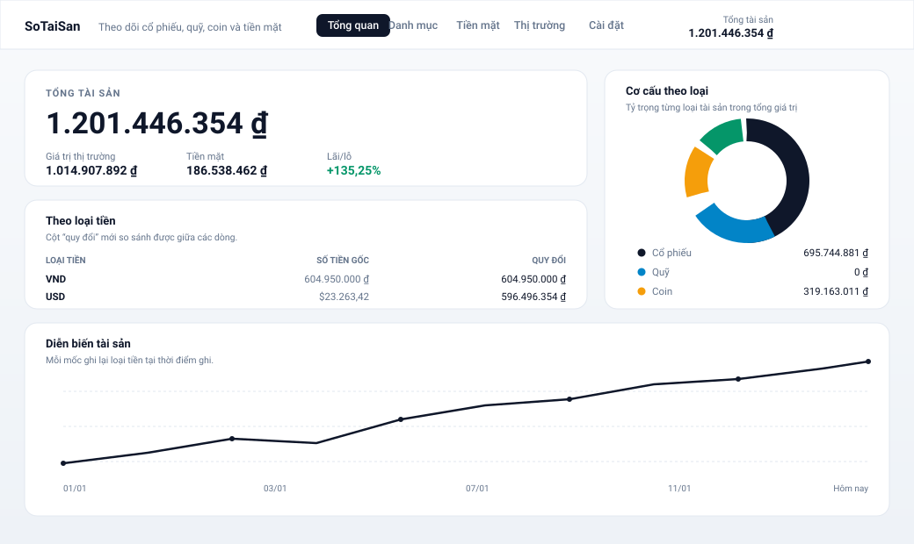

# SoTaiSan

A small, self-hosted tracker for **what you own and what it is worth**.

Inspired by [aurelio-finance](https://github.com/LosaLosSantos/aurelio-finance),
reduced to one job. Six things can be tracked — **stocks, funds, crypto, cash,
term deposits (savings), and gold** — in **VND and USD**, read in **Vietnamese
or English**. That is the whole feature list; see [Scope](#scope) for what was
deliberately left out.



## Run it

You need [Node.js](https://nodejs.org) 22 or later with `pnpm`, and
[uv](https://docs.astral.sh/uv/). Then:

```bash
./start.sh              # your own records, in backend/data.db
./start.sh --demo       # an invented portfolio, in backend/demo.db
./start.sh --no-browser # start it without opening a browser
```

The first run installs what it needs and opens <http://localhost:8010>. Nothing
else listens, nothing is uploaded, and your records never leave the machine.

### Development

```bash
cd backend  && uv run uvicorn app.main:app --port 8010   # API with reload
cd frontend && pnpm dev                                  # UI with hot reload
```

The dev server proxies `/api` to the backend, so the frontend always uses
relative paths and there is no CORS surface in either mode.

### Tests

```bash
cd backend  && uv run pytest      # 360 tests, no network access
cd frontend && pnpm test          # 24 tests: formatters, dictionaries, layout

# and, against a running server with the real network:
./scripts/acceptance.sh           # the acceptance criteria from docs/SPEC.md §9
```

The backend suite replaces every outbound call with a fake, so it passes on a
plane. That is asserted by the fixtures in `backend/tests/conftest.py`, not by
convention.

## What it does

**Overview** — the total across everything, split by kind and by currency,
against a recorded history, with anything that could not be converted listed
rather than quietly dropped.

**Holdings** — stocks, funds and crypto, priced automatically. Listed things
come from Yahoo Finance; a Vietnamese **open-ended fund** (quỹ mở) has no
ticker and no session close, so its price is the **NAV published by Fmarket**,
once a day. The Market page says which of the two each number came from,
because they are not the same kind of fact. A position carries a quantity and,
optionally, what it cost; leave the cost blank and gain is reported as unknown
rather than invented.

**Selling** — a position can be sold in part or in full: you say how many units
went and how much money came back, and the cost it released is worked out in
proportion to what was sold (a position stores one total cost, not a list of
purchases, so proportional is the only answer that is not a guess). The gain is
then **kept**: the sale stays in a short list of closed trades under the table,
and the Overview adds it to the gain still unrealised, so selling a loser does
not make the loss disappear from the page.

**Cash** — **one balance per currency**: a balance in đồng and a balance in
dollars, there from the first time you look, never added to and never removed.
Money goes in and comes out from the page itself — an amount, a direction, a day
and a reason ("Lương tháng 10", "Tiền nhà") — and when you would rather just
type the number, editing the balance in place is still one action. The reason is
free text on purpose: no category, no month, no total by type, because that is
the budgeting tool this app deliberately is not.

Every change to a balance leaves a **line**: a trade, money you put in or took
out, and the difference when you count your money and it is not what the page
said. So the figure at the top is the sum of the lines under it — including for
money that was in the pot before there were any lines, which gets one opening
line of its own rather than being a silent starting number.

**Cash-linked trades** — one switch in Settings, **off by default**. With it off,
cash and holdings are two facts you type, which is what entering a portfolio you
already own requires: nobody bought those shares out of the balance you are
about to write down. Turn it on and every later trade moves money and leaves a
line — buying takes the cost out of the balance in that trade's own currency,
selling puts the proceeds back, opening a term deposit moves the principal and
maturing one pays it back into the same balance. Editing what something cost
moves the difference, and deleting a holding gives back what the balance
actually paid and has not already had returned. A trade quoted in a currency
there is no balance in — a EUR listing — is reported rather than converted at an
invented rate.

**Gold** — Vietnamese gold, priced the way it is actually bought and sold: by
the **chỉ**, at **Bảo Tín Minh Châu's published price** for the exact product
line you hold. Vietnamese gold does not follow the world price — SJC bars and
rings carry a domestic premium, and that premium is most of the money — so the
app reads a Vietnamese shop rather than a world feed. Each holding says which of
the shop's two prices it uses, because the shop buys at one and sells at the
other and valuing gold at the selling price shows a profit on gold bought a
moment ago — and because that asking price is what a "gold price" means: the
figure in every headline. Both are shown per **lượng** and per **chỉ**, since a
price without its unit is a number that can be ten times wrong.

**Savings** — term deposits: the bank, the principal, the rate the contract
quotes, and the term. You do not retype its value, because the app can work it
out: interest accrues by the day, and the card shows what it is worth today,
how much of that is interest, and what it will pay at maturity. When a term
matures the interest stops — that is a fact about the contract, not a bug — and
the card offers the two things that can happen next: **roll it over** (the
interest becomes the new principal) or **withdraw it**, which closes the
deposit and records the proceeds as cash in one step so the same money is never
counted twice.

**Market** — every stored price and exchange rate with the dates that make them
readable: the session a close belongs to, when it was fetched, and whether a
rate is a published one or the placeholder used offline.

**Settings** — the display currency, the language and whether trades move cash,
the path to your database file so you know what to back up, and a wipe that
deletes every record behind a confirmation (keeping your settings and the cached
rates).

Refreshing is one button in the header. What it did is then reported under it,
per symbol: a feed that answered for nineteen holdings and not the twentieth is
one line of news, not a failure of the page.

## How the numbers stay honest

Three rules, each of which is enforced in code and covered by tests:

1. **A total is a sum of conversions, never a sum across mixed units.** Every
   figure is converted into one display currency before it is added to
   anything, by `backend/app/fx.py`.
2. **An unknown figure is unknown, never zero.** A position with no price, no
   cost, or a quote in a currency this app cannot convert is excluded from the
   total and listed with the reason — a total that is short says so.
3. **A number travels with its currency and its date.** A rate is stored per
   day and per base; a valuation records the currency it was written in, so
   changing the display currency later never rewrites history.
4. **A derived figure is derived the way the contract says.** Deposit interest
   is simple, on actual days held over a 365-day year, and stops at maturity —
   not compounded daily, which would overstate every figure by about 1.4 % and
   would not match the bank's own statement.
5. **A price is per unit, and the unit travels with it.** Gold is quoted per
   lượng by a shop and held in chỉ, and a price divided by the wrong weight is
   wrong by a factor of ten. So the unit is parsed from the shop's own product
   name, normalised to one unit, and a line whose weight cannot be read is
   dropped rather than guessed at — and the page shows both the shop's published
   figure and the price per unit held.
6. **Closing a position moves the gain, it does not erase it.** Writing a sale
   down is what keeps the total honest: selling a position at the market price
   leaves the portfolio's total gain *exactly* where it was, with the figure
   simply moved from "unrealised" to "realised". Without that record the loss
   would vanish from the page the moment the position left the table — the one
   way this app could be used to tell yourself a story. The test for it is
   `backend/tests/test_realized.py::TestTheDashboardTotals`.
7. **Moving money between two tables changes neither.** With the cash link on,
   a purchase takes from a balance and a sale puts back; the balance and the
   history are written from one number, so they cannot disagree, and a delete
   refunds what the balance actually paid rather than what the holding is
   measured against — otherwise a partly-sold position would print money on the
   way out.
8. **A balance is the sum of its history.** Every change writes a line — a
   trade, money in or out, or the correction when a counted balance differs —
   and money that predates the history gets one opening line rather than a
   silent figure. `GET /api/portfolio` returns the lines; the Cash page prints
   one figure and claims it is their sum, and that claim is tested.
9. **A balance cannot be split, and an old one is not rewritten in silence.**
   Cash is one pot per currency, so a trade has no account to be recorded in by
   mistake. A database from before that rule — two dong balances, say — is
   merged at startup, and a copy of the file is written beside it first: the
   balances are added up, the movement history is carried across rather than
   cascaded away, and the merge is logged. See `merge_cash_pots` in
   `backend/app/database.py`.

## Supported symbols

**Listed** (Yahoo Finance tickers): `AAPL` (US), `VIC.VN` and `FPT.VN` (HOSE),
`VWCE.DE` (Xetra), `BTC-USD` and `BTC-EUR` (crypto pairs), `VOO` (US ETF).

**Vietnamese gold** (Bảo Tín Minh Châu, per chỉ): any of the shop's published
lines — `VÀNG MIẾNG SJC`, `NHẪN TRÒN TRƠN`, `VÀNG NGUYÊN LIỆU`, `TRANG SỨC` —
picked from a list rather than typed.

**Open-ended Vietnamese funds** (Fmarket NAV): `VNDAF`, `VESAF`, `VFF`, `VEOF`,
`DCDE`, `DCDS`, `DCBF`, `DCIP` and about sixty more. A few of Dragon Capital's
funds are published by Fmarket under the fund company's internal code while the
certificate uses another — `DCDE` is `VFMVF4`, `DCDS` is `VFMVF1` — and both
names work: `backend/app/funds.py::ALIASES` maps between them, and the picker
shows the platform's code beside the name so the same fund is not mistaken for
two.

Type a name to search, or type the code directly — the search is a convenience,
never a gate.

**Why a fund is not a stock.** A fund certificate is not listed on an exchange,
so there is no ticker and no closing price: what it has is a NAV, published once
a day by the fund's management company. That is why the table on the Market page
has a "source" column.

**Why an ETF listed in EUR shows as "cannot convert".** This app holds two
currencies. A quote in a third is reported, with its price and its date, but it
is not converted — because converting it would mean inventing a rate for a
currency you told the app you do not hold. Prefer a VND- or USD-quoted listing
(`VOO` rather than `VWCE.DE`) if you want it in the total.

## Scope

Deliberately **not** here, in contrast to the project this was reduced from:

- the world gold price, or silver — this tracks Vietnamese gold at a Vietnamese
  shop's price
- interest payment schedules other than "at maturity" (coupons, monthly payouts)
- goals, targets, planning, accumulation plans
- any AI advisor, chat, or agent — no OpenRouter, no MCP, no web search
- income, expenses, budgets, cash-flow analysis
- debts, liabilities, mortgages, real assets, insurance, pensions
- look-through composition, dividends, tax reporting
- a transaction ledger: a sale is recorded, and so is each movement of a cash
  balance, but the buys behind a position are not — a position carries one total
  cost, which is why a partial sale releases a proportional part of it
- separate cash accounts per bank: one balance per currency, because a user has
  a bank balance, not a list of piles to choose between
- accounts, sync, multi-user; anything that leaves this machine
- currencies other than VND and USD

`backend/tests/test_scope.py` fails if any of that grows back.

## Repository layout

```
backend/app/
  money.py          the shared vocabulary: currencies, kinds, languages
  database.py       SQLite engine, session, the instrument-registering hook
  models.py         the nine tables
  market.py         Yahoo Finance: what a symbol is, what it closed at
  fx.py             rates, and the rule that keeps a total honest
  cash.py           one cash balance per currency, and merging older ones
  deposits.py       term deposits: the interest arithmetic, in one place
  realized.py       selling: the proportional cost a sale releases, in one place
  movements.py      cash in and out: one signed movement per trade, in one place
  gold.py           Vietnamese gold: the shop's payload, the units, the prices
  net.py            one HTTPS helper, because one feed needs certifi
  funds.py          open-ended funds: NAVs from Fmarket, and the alias table
  valuation.py      what it is all worth, in one currency
  pricing.py        refreshing, and reporting per-symbol failures
  settings_store.py the display currency and the language
  routers/          assets, realized, cash, deposits, gold, portfolio, market,
                    settings

frontend/src/
  api/              one function per endpoint, and the types it returns
  i18n/             the dictionaries, t(), and every formatter
  state/            the shared settings/portfolio state
  components/       the interface kit and the symbol picker
  views/            Overview, Holdings, Cash, Savings, Gold, Market, Settings
```

## Documentation

- [docs/SPEC.md](docs/SPEC.md) — what this is, in detail: the domain model, the
  currency and pricing rules, the API, and the acceptance criteria.
- [docs/PLAN.md](docs/PLAN.md) — how it was built, milestone by milestone, with
  the risks that shaped each decision.

## License

MIT — see [LICENSE](LICENSE).
